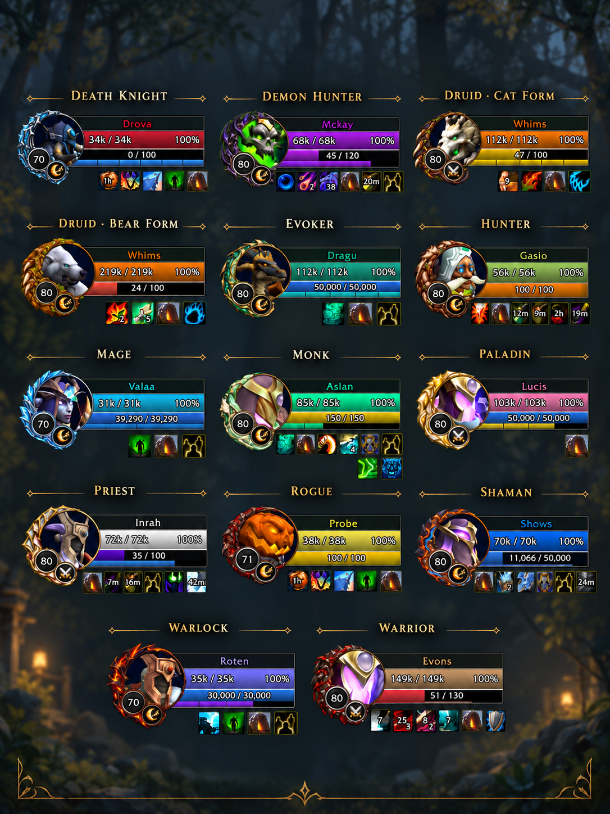
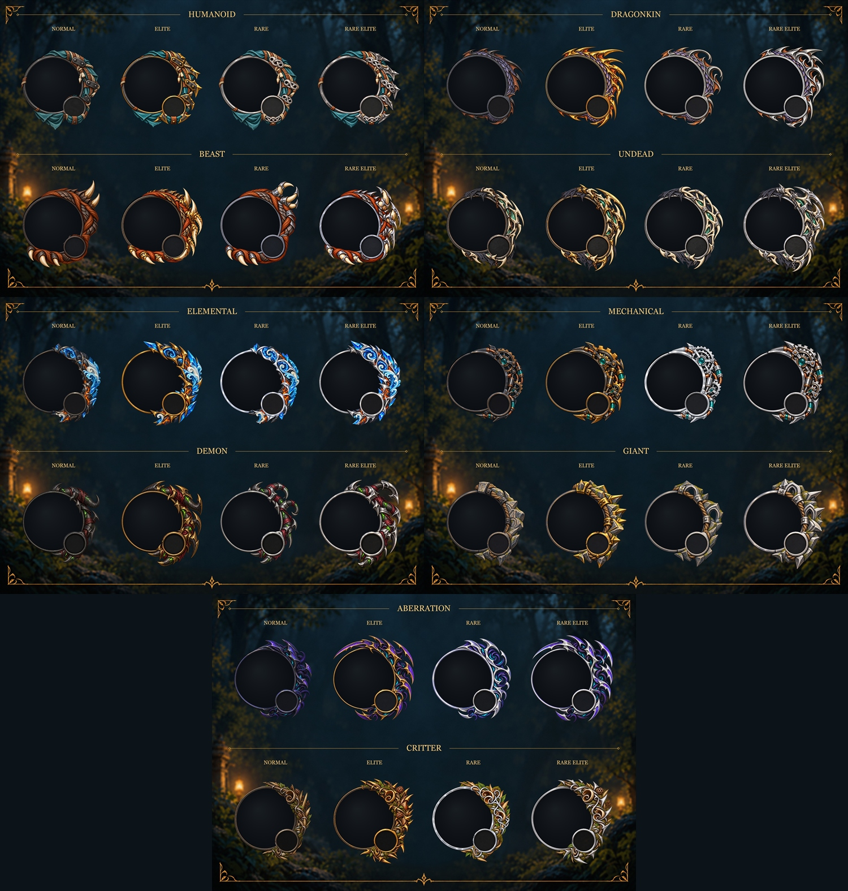

# Good Unit Frames

Class-themed **Player and Target frames** for **Retail** and **Forever** (**Classic** is untested).

**Open options: `/guf`**

## Choose your look

- **Artistic:** Class, spec and creature-themed portrait ornaments with flexible bars. Enabled by default.
- **Blizzard:** The familiar Blizzard frames with extra customization.
- Different layouts and styles coming in the future.

## Features

- **80 portrait designs:** 40 class/spec designs and 40 monster designs across 10 creature families.
- **Distinct creature ranks:** Normal, Rare, Elite and Rare Elite artwork.
- **Make it yours:** Adjust position, scale, fonts, colors, textures and text formats.
- **Auras and cast bars:** Customize buffs, debuffs, cast bars and supported indicators/resources.
- **Interactive previews:** Inspect changes without needing a live target.
- **Profiles:** Save named account-wide setups and copy settings between frames.

## Getting started

1. Type `/guf` to open options.
2. Choose your layout under **General**.
3. Customize **Unit Configuration > Player** or **Target** using the interactive preview.

## Monster artwork

View the creature families and rank variations

## Feedback

[Report a bug or request a feature](https://github.com/CoreAccess/GoodUnitFrames/issues). Include your client/version, layout, reproduction steps and any Lua error or screenshot.

Version **1.0.0** is being prepared for the first public release. CurseForge download details will be added when available.

## Disclaimer

Yes the in-game portrait ornaments were AI generated. I know how people feel about AI generated art but I'm not skilled enough to create them myself and I'm broke so AI generated it is. I understand if that makes you avoid using the addon. I just wanted to be completely transparent about it up front.
